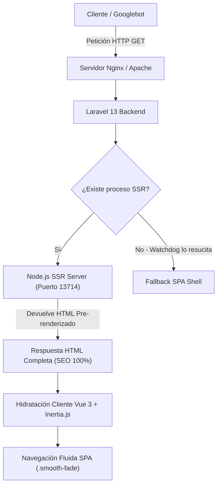

<div align="center">

# 🚀 CMS SSR — Laravel + Vue + Inertia

**Sistema de Gestión de Contenidos (CMS) de alto rendimiento, optimizado para SEO y con arquitectura de renderizado en servidor (SSR).**

[](https://laravel.com)
[](https://vuejs.org)
[](https://inertiajs.com)
[](https://primevue.org)
[](https://php.net)
[](CHANGELOG.md)
[](LICENSE)

</div>

---

## 📌 Descripción General

**CMS SSR** es un CMS profesional desarrollado bajo patrones **Clean Architecture** y principios **SOLID**. Combina la robustez del backend de **Laravel 13** con la velocidad reactiva de **Vue 3** e **Inertia.js**, utilizando un servidor de renderizado **Node.js (SSR)** para garantizar una indexación inmediata en motores de búsqueda como Google.

Está diseñado para gestionar sitios web dinámicos, periódicos digitales o blogs corporativos que requieran miles de contenidos con tiempos de respuesta instantáneos y un diseño premium basado en **PrimeVue v4**.

---

## ✨ Características Destacadas

### ⚡ 1. Arquitectura SSR & SEO de Alta Eficiencia
- **Server-Side Rendering (SSR)**: Generación del código HTML semántico completo en el servidor mediante Node.js en la primera visita (`curl` friendly para buscadores).
- **Core Web Vitals (CLS = 0.0)**: Navegación SPA interna sin recargas duras ni saltos de pantalla gracias a transiciones de opacidad puras (`.smooth-fade`) y contenedores fijados (`min-h`).
- **SEO Automático**: Metadatos `OpenGraph`, `Twitter Cards` y microdatos `JSON-LD` (Schema.org) generados dinámicamente mediante `SeoService`.
- **Generador de Sitemap XML**: Creación automática diaria del mapa del sitio en `/sitemap.xml`.
- **Payload Optimizado**: El atributo `data-page` oculta las rutas de administración (`ziggy: null`) y datos sensibles en peticiones públicas, reduciendo la carga hasta un 80%.

### 🎨 2. Interfaz de Usuario y Sistema de Diseño (PrimeVue v4)
- **Tema Personalizado Aura**: Paletas Tailwind tailoreadas con **Emerald (Esmeralda)** como color primario y **Zinc (Pizarra)** para superficies.
- **Soporte Nativo de Modo Oscuro**: Detección automática y conmutación fluida sin parpadeos visuales (FOUC).
- **Iconografía Vectorial**: Uso de **PrimeIcons (`pi pi-*`)** en todos los selectores, menús y tarjetas de contenido (cero emoticonos HTML).

### 🧩 3. Módulos y Funcionalidades del CMS
- **Editor Visual de Menús**: Creación y edición de elementos de navegación con modal `Dialog` de PrimeVue, selectores con búsqueda (`Select filter`) y resolución dinámica de enlaces.
- **Categorías y Plantillas Flexibles**:
  - **Grids de columnas ajustables**: Personalización por dispositivo (móvil, tablet, escritorio), alineación horizontal (`start`, `center`, `end`) y separación (`gap`).
  - **Ordenación Configurable de Artículos**: Soporte para 5 criterios (Fecha reciente, Fecha antigua, Alfabético A-Z, Alfabético Z-A y **Orden Manual Drag & Drop**).
  - **Etiqueta SEO de Título Configurable**: Elige la etiqueta HTML (`H1`, `H2`, `H3`, `H4`) de los títulos en tarjetas.
  - **Validación Anti-Bucle**: Exclusión de la propia categoría en el selector de categoría padre.
- **Publicaciones y Artículos**:
  - **Reordenamiento Drag & Drop en Panel**: Arrastra y suelta filas en `/panel/articulos` con persistencia en tiempo real en la base de datos.
  - **Ciclo de vida y expiración en tiempo real**: `draft` (despublicado), `scheduled` (programado automático), `published` (publicado activo) y `expired` (expirado/finalizado). Soporte para fecha de fin y publicación indefinida.
  - **Optimización WebP**: Conversión automática de imágenes subidas a formato WebP y compresión de SVGs.
  - **Usabilidad y Adaptabilidad Responsive**: Barra de acciones superior/inferior, maquetación en 2 columnas y navegación de pestañas optimizada para móvil y desktop.
  - **Cálculo automático de tiempo de lectura** y contador atómico de visitas (`views_count`).
  - **Papelera de reciclaje y eliminación suave** (`SoftDeletes`).
- **Módulo Autónomo de Descargas y Distribución de Software (`App\Modules\Downloads`)**:
  - **Bóveda Privada Blindada**: Almacenamiento fuera de `public/` con inspección anti-Zip Slip, anti-Zip Bomb, validación de *Magic Bytes* y huella criptográfica `SHA-256`.
  - **Entrega Firmada Anti-Hotlinking**: URLs temporales HMAC ligadas a `IP + sesión`, redirección SEO ante enlaces externos (*hotlinking*), soporte opcional `X-Accel-Redirect` (Nginx) y telemetría RGPD diferida (`afterResponse`) sin alterar `updated_at`.
  - **Integración Total con Page Builder y SEO**: Maquetación visual de portada y plantilla de ficha individual (`{download.*}`), bloque de descarga sticky, Schema.org `SoftwareApplication` + `Offer` y arquitectura lista para monetización futura.
- **Configuración Global del Sitio**: Ajustes de nombre, descripción, logotipos claro/oscuro con control de altura independiente en escritorio y móvil, tema inicial anti-FOUC (`light`, `dark`, `system`), favicon, fuentes tipográficas y redes sociales desde el panel de administración.

### 🛡️ 4. Seguridad y Resiliencia
- **Cabeceras HTTP de Seguridad y CSP Estricta (Nota A+ en MDN Observatory)**: Middleware global `SecurityHeaders` compatible con caché Redis RAM, Page Builder, Turnstile, Google Maps, Leaflet y GA4, utilizando hashes criptográficos SHA-256 y `nonces` dinámicos sin `'unsafe-inline'` en `script-src`.
- **Roles y Permisos**: Control de acceso basado en roles con `Spatie/Laravel-Permission` (`admin`, `gestor`, `encargado`, `empleado`).
- **Centro de Actividad, Telemetría IP y Auditoría (`spatie/laravel-activitylog` v5.1)**: Panel exclusivo para administradores (`/panel/actividad`) con registro de IPs de descargas, históricos perpetuos inmunes a limpiezas, auditoría Antes/Después de modelos y registro de accesos/fallos de login.
- **Protección contra Inyecciones**: Validaciones rigurosas con `FormRequests` de Laravel.
- **Watchdog de Proceso SSR**: Un guardian en `routes/console.php` monitoriza el puerto `13714` mediante el cron de Laravel, auto-reiniciando el motor Node.js si el servidor se reinicia o sufre una caída.

---

## 🏗️ Diagrama de Arquitectura



---

## 🛠️ Stack Tecnológico

| Capa | Tecnología | Descripción |
| :--- | :--- | :--- |
| **Backend** | PHP 8.4 + Laravel 13.x | Framework principal |
| **Frontend** | Vue 3 + Inertia.js v2 | Arquitectura SPA / SSR |
| **Componentes UI** | PrimeVue v4 + PrimeIcons | Sistema de diseño profesional (Aura Theme, carga diferida solo en panel) |
| **Estilos** | TailwindCSS v4 | Estilizado utilitario y responsive |
| **SSR Engine** | Node.js (vue/server-renderer) | Renderizado en servidor |
| **SEO & Sitemaps** | SEOMeta + Spatie SchemaOrg | Metadatos y microdatos estructurados |
| **Seguridad** | Spatie Laravel Permission | Gestión de roles y RBAC |

---

## 💻 Requisitos del Sistema

- **PHP**: `>= 8.4`
- **Node.js**: `>= 20.x` & **npm**: `>= 10.x`
- **Base de Datos**: MySQL `>= 8.0` / MariaDB `>= 10.5`
- **Servidor Web**: Nginx o Apache con módulo `mod_rewrite` y soporte SSL (HTTPS)

---

## 📦 Instalación Local

### 1. Clonar el repositorio
```bash
git clone https://github.com/francishift/CMS-SSR-Laravel-Vue-Inertia.git
cd CMS-SSR-Laravel-Vue-Inertia
```

### 2. Instalar dependencias PHP y Node
```bash
composer install
npm install
```

### 3. Configuración del entorno (`.env`)
```bash
cp .env.example .env
php artisan key:generate
```
Configura los datos de conexión a tu base de datos en el archivo `.env`:
```env
DB_CONNECTION=mysql
DB_HOST=127.0.0.1
DB_PORT=3306
DB_DATABASE=nombre_base_datos
DB_USERNAME=usuario_db
DB_PASSWORD=contrasena_db
```

### 4. Migraciones y Datos de Prueba (Seeding)
```bash
php artisan migrate --seed --class=CmsSeeder
```

### 5. Compilar Assets y Ejecutar el Servidor SSR
```bash
# Compilar cliente y servidor SSR
npm run build

# En una terminal, arrancar el servidor SSR de Node
php artisan inertia:start-ssr

# En otra terminal, arrancar el servidor de desarrollo PHP
php artisan serve
```

---

## 🚀 Despliegue en Producción

El proyecto incluye un script de despliegue automático optimizado (`deploy.sh`):

```bash
bash deploy.sh
```

El script ejecuta automáticamente los siguientes pasos:
1. Activa el modo mantenimiento (`artisan down`).
2. Actualiza el código desde Git (`git pull`).
3. Instala dependencias de composer (`--no-dev --optimize-autoloader`).
4. Ejecuta migraciones (`artisan migrate --force`).
5. Compila assets para cliente y servidor SSR (`npm run build`).
6. Reconstruye cachés de rutas, configuración y eventos.
7. Reinicia el proceso Node SSR (`pkill` / `nohup node bootstrap/ssr/ssr.js`).
8. Desactiva el modo mantenimiento (`artisan up`).

---

## 🧪 Pruebas Automatizadas

El proyecto incluye una suite de pruebas automatizadas con **PHPUnit** para garantizar la estabilidad de los módulos:

```bash
php artisan test
```

```text
PASS  Tests\Feature\Auth\AuthenticationTest
PASS  Tests\Feature\SecurityHeadersTest
PASS  Tests\Feature\PublicResponseCacheTest
PASS  Tests\Feature\SeoCanonicalAndDuplicateUrlsTest
...
Tests:    242 passed (1179 assertions)
Duration: ~12s
```

---

## 📁 Estructura de Documentación

Para obtener detalles específicos sobre la arquitectura del código, consulta los documentos de la carpeta `/docs`:

- 📖 [Arquitectura y Principios SOLID](docs/arquitectura.md)
- 📖 [Guía de Instalación Detallada](docs/instalacion.md)
- 📖 [Stack Tecnológico](docs/stack.md)
- 📖 [Caché de Respuesta Redis e Invalidación Instantánea](docs/cache-redis-respuesta.md)
- 📖 [Configuración de SEO, SSR y Rendimiento](docs/configuracion-seo-ssr.md)
- 📖 [Cabeceras HTTP de Seguridad y CSP](docs/cabeceras-seguridad-csp.md)
- 📖 [Guía de Diseño, UI Frontend y Rendimiento Público](docs/frontend-ui.md)
- 📖 [Constructor Visual de Páginas (Page Builder)](docs/page-builder.md)
- 📖 [Módulo de Menús y Navegación](docs/modulo-menus.md)
- 📖 [Módulo de Categorías y Esquemas Extra](docs/modulo-categorias.md)
- 📖 [Módulo de Artículos y Publicación](docs/modulo-articulos.md)
- 📖 [Módulo Autónomo de Descargas y Bóveda Privada](docs/modulo-descargas.md)
- 📖 [Módulo de Formularios Dinámicos](docs/modulo-formularios.md)
- 📖 [Biblioteca de Medios y Optimización WebP](docs/modulo-medios.md)
- 📖 [Módulo de Mapas (Leaflet / Google Maps)](docs/modulo-mapas.md)
- 📖 [Módulo de Usuarios y Roles](docs/modulo-usuarios.md)
- 📖 [Centro de Actividad, Telemetría IP y Auditoría Spatie](docs/modulo-actividad-logs.md)
- 📖 [Autenticación y OAuth con Google](docs/autenticacion-oauth-google.md)
- 📖 [Suite de Pruebas Automatizadas y Testing](docs/testing.md)
- 📖 [Reglas de Desarrollo del Proyecto](docs/reglas-desarrollo.md)
- 📋 [Historial de Versiones (CHANGELOG)](CHANGELOG.md)

---

## 📄 Licencia y Atribución

Este proyecto está liberado como código abierto bajo los términos de la licencia **[GNU General Public License v3.0 (GPL-3.0)](LICENSE)**.

> **Aviso de Derechos de Autor (Sección 4 y 7b de la Licencia GPL-3.0)**:  
> Cualquier copia, modificación, distribución o derivación de este software **debe conservar intactos de manera obligatoria** todos los avisos de derechos de autor (`Copyright (C) 2026 Francis Valenzuela`) y los comentarios de atribución original presentes en el código fuente.

---

<div align="center">
Desarrollado con ❤️ por <b>Francis Valenzuela</b>
</div>
