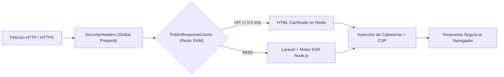

# Cabeceras HTTP de Seguridad y Content Security Policy (CSP)

## 1. Visión General

El CMS implementa una capa global de endurecimiento HTTP diseñada para obtener la máxima calificación (**Nota A / A+**) en auditorías como **MDN HTTP Observatory** y **Google Lighthouse (Best Practices)** sin penalizar el tiempo de respuesta (`0 ms` de sobrecarga) ni romper la caché de página completa en RAM de Redis (`PublicResponseCache`), el renderizado SSR o el maquetador visual (`Page Builder`).

Toda la lógica está desacoplada en tres piezas con responsabilidad única:

- **`app/Http/Middleware/SecurityHeaders.php`**: Middleware global registrado al inicio de la pila HTTP (`$middleware->prepend(...)` en `bootstrap/app.php`) y en el manejador de excepciones `403/404/500/503`.
- **`app/Support/CspInlineScripts.php`**: Repositorio inmutable de los micro-scripts inline críticos de arranque (inicialización síncrona de tema claro/oscuro sin FOUC y puente de redirección de canales nativos) junto con el cálculo automático de sus hashes criptográficos `'sha256-...'`.
- **`config/security.php`**: Archivo de configuración declarativo con las políticas y listas blancas de orígenes de terceros extensible vía variables `.env`.

---

## 2. Flujo de Ejecución con Caché en RAM de Redis



Al situarse **por delante** de `PublicResponseCache`, incluso las páginas anónimas servidas directamente desde la memoria RAM de Redis incluyen siempre todas las cabeceras defensivas actualizadas. Además, para eliminar cualquier sobrecarga en ráfagas de recursos multimedia (`/media/render` WebP, descargas binarias o respuestas JSON puras), `SecurityHeaders` detecta el `Content-Type` y aplica el cálculo completo de `Content-Security-Policy` exclusivamente a documentos HTML/XHTML, manteniendo en binarios las cabeceras ligeras esenciales (`X-Content-Type-Options: nosniff` y eliminación de `X-Powered-By`).

---

## 3. Cabeceras Defensivas Aplicadas

| Cabecera | Valor Aplicado | Propósito y Decisiones de Arquitectura |
| :--- | :--- | :--- |
| **`Content-Security-Policy`** | Política estricta por directivas | Bloquea inyecciones XSS y carga de scripts no autorizados (`object-src 'none'`, `base-uri 'self'`, `form-action 'self'`, `frame-ancestors 'self'`). |
| **`X-Frame-Options`** | `SAMEORIGIN` | Impide ataques de *Clickjacking* desde dominios externos manteniendo operativos los iframes internos de vista previa del constructor (`*builder/preview-frame*`). |
| **`X-Content-Type-Options`** | `nosniff` | Evita que el navegador ejecute archivos subidos en `/storage` o `/media` adivinando su MIME type. |
| **`Referrer-Policy`** | `strict-origin-when-cross-origin` | Preserva la analítica de tráfico saliente sin exponer rutas internas privadas (`/panel/*`) en cabeceras `Referer` hacia terceros. |
| **`Cross-Origin-Opener-Policy`** | `same-origin-allow-popups` | Aísla el contexto de navegación (`window.opener`) permitiendo ventanas emergentes legítimas como OAuth con Google. |
| **`X-Permitted-Cross-Domain-Policies`** | `none` | Bloquea políticas de carga cruzada heredadas (Flash/PDF). |
| **`Permissions-Policy`** | Restringida al mínimo | Desactiva acceso a cámara, micrófono, USB, MIDI y pagos; limita `fullscreen`, `autoplay`, `picture-in-picture` y `geolocation` únicamente a `(self)`. |
| **`X-Powered-By`** | *Eliminada* | Oculta la versión exacta de PHP (`header_remove('X-Powered-By')`). |
| **`Strict-Transport-Security`** | Gestionada en Nginx (opcional en PHP) | Desactivada por defecto en PHP (`SECURITY_HSTS_ENABLED=false`) cuando Nginx/Plesk ya emite HSTS en el borde SSL, evitando duplicar la cabecera según RFC 6797. |

> **Nota sobre COEP (`Cross-Origin-Embedder-Policy`)**: No se fuerza `require-corp` porque bloquearía integraciones externas esenciales del CMS (Cloudflare Turnstile, Google Maps y servidores de tiles de OpenStreetMap) que no emiten cabeceras CORP.

---

## 4. Estrategia Híbrida de CSP: Hashes SHA-256 + Nonces Dinámicos

Para cumplir los estándares estrictos de CSP, la directiva `script-src` **no utiliza `'unsafe-inline'` ni `'unsafe-eval'`**:

1. **Rutas Públicas Cacheadas en Redis (`Hashes SHA-256`):**
   - Si se usara un `nonce` aleatorio en páginas cacheadas por `PublicResponseCache` durante 24 horas, el atributo `<script nonce="...">` almacenado en Redis quedaría desincronizado respecto a la cabecera generada en siguientes visitas.
   - Por ello, los scripts críticos de tema en `resources/views/app.blade.php`, `resources/views/errors/404.blade.php` y el puente de protocolos nativos (`/whatsapp`, `/llamar`, `/email` en `PublicContactRedirectController`) se renderizan desde constantes en `CspInlineScripts` y se autorizan mediante sus hashes exactos `'sha256-...'`.
   - `CspInlineScripts::publicThemeScript($mode, $defaultTheme)` resuelve de forma determinista entre las 5 variantes estáticas del tema público (`PUBLIC_THEME_LIGHT`, `PUBLIC_THEME_DARK`, `PUBLIC_THEME_USER_CHOICE_LIGHT`, `PUBLIC_THEME_USER_CHOICE_DARK` y `PUBLIC_THEME_USER_CHOICE_SYSTEM`), cuyos hashes están pre-autorizados en `CspInlineScripts::publicHashes()` para respetar `frontend_default_theme` desde el primer milisegundo sin parpadeos (FOUC) ni conflictos con la caché Redis.
   - En `PublicContactRedirectController`, la URL de destino se inyecta de forma escapada en el atributo HTML `data-destination` del `<body>`, manteniendo el código JavaScript 100% estático e inmune a inyecciones en contexto de script.

2. **Panel de Administración, Autenticación y Preview del Builder (`Nonce` por petición):**
   - Las rutas privadas (`/panel*`, `/acceso*`, `*builder/preview-frame*`, etc.) nunca se almacenan en `PublicResponseCache` e inyectan las rutas dinámicas de Ziggy mediante `@routes(null, $cspNonce)`.
   - `SecurityHeaders` genera un `nonce` criptográfico de 128 bits (`random_bytes(16)`) único en cada petición y lo añade automáticamente a `script-src`.

3. **Desarrollo Local con Vite HMR (`npm run dev`):**
   - Si existe el archivo `public/hot`, el middleware omite automáticamente la cabecera CSP para permitir los scripts inline y conexiones WebSocket locales del servidor de desarrollo de Vite sin fricción.

---

## 5. Orígenes Dinámicos por Integración y Ampliación vía `.env`

Siguiendo el principio de mínimo privilegio para un CMS reutilizable multi-proyecto, `SecurityHeaders` **solo añade a la cabecera CSP los servicios de terceros que estén realmente activos en cada instalación**:

- **Núcleo siempre disponible:** `'self'`, mapas libres OpenStreetMap / Leaflet 1.9.4 / Carto / Nominatim e iframes estándar de vídeo/mapas (`YouTube`, `Vimeo`, `Google Maps Embed`, `OpenStreetMap`).
- **Cloudflare Turnstile (`https://challenges.cloudflare.com`):** Se inyecta automáticamente en `script-src`, `connect-src` y `frame-src` **únicamente** cuando `TURNSTILE_SITE_KEY` y `TURNSTILE_SECRET_KEY` están configuradas en `.env` **y** existe al menos un formulario activo con protección anti-spam activada (`Form::hasAnyCaptchaEnabled()`).
- **Google Analytics 4 / Tag Manager (`googletagmanager.com`, `*.google-analytics.com`):** Se inyecta automáticamente **únicamente** cuando la analítica está activada y tiene ID de medición en `SiteSetting`.
- **Google Maps JavaScript API (`maps.googleapis.com`, `maps.gstatic.com`):** Se inyecta automáticamente cuando existe `google_maps_api_key` configurada en `SiteSetting` (o dentro del panel de administración para previsualización).
- **Caché unificada de integraciones CSP (`cms_csp_active_integrations`):** El estado de las integraciones activas se resuelve en un único mapa plano en caché e invalida de forma automática al guardar o eliminar registros en `Form` o `SiteSetting`.

### Normalización automática de eventos inline en contenido editorial (`onclick`)

Bajo CSP estricto (sin `'unsafe-inline'`), los navegadores bloquean atributos HTML `on*` inline. Para evitar errores en consola o botones inoperativos cuando un editor inserta HTML enriquecido con llamadas estándar como `onclick="window.open('https://...', '_blank')"` o `onclick="location.href='/contacto'"`, `useSanitize.js` (`normalizarEventosInlineHtml`) y `ElementHtml.vue` convierten automáticamente dichos manejadores —tanto en SSR como en cliente— en atributos declarativos seguros (`data-cms-open-url` y `data-cms-open-target`) delegados globalmente desde `PublicLayout.vue` (usando navegación SPA de Inertia para enlaces internos y `noopener,noreferrer` para externos), descartando cualquier esquema inseguro (`javascript:`).

### Añadir nuevos dominios externos sin tocar código

Si en el futuro se inserta en un bloque `ElementHtml` del Page Builder un widget externo nuevo (por ejemplo, Calendly o Stripe), basta con declarar sus orígenes separados por comas en el archivo `.env`:

```env
SECURITY_HEADERS_ENABLED=true
CSP_ENABLED=true
CSP_REPORT_ONLY=false

# Orígenes adicionales opcionales separados por comas
CSP_EXTRA_SCRIPT_SRC="https://assets.calendly.com"
CSP_EXTRA_FRAME_SRC="https://calendly.com"
CSP_EXTRA_CONNECT_SRC=""
CSP_EXTRA_STYLE_SRC="https://assets.calendly.com"
```

Tras modificar `.env` en producción, si la configuración está cacheada recuerda ejecutar `php artisan config:clear`.

---

## 6. Pruebas Automatizadas

La suite verifica matemáticamente la validez de todas las cabeceras y que cualquier `<script>` ejecutable inline renderizado en las vistas coincida byte a byte con su hash SHA-256 o `nonce` en `script-src`:

```bash
php artisan test tests/Unit/Support/CspInlineScriptsTest.php tests/Feature/SecurityHeadersTest.php
```
