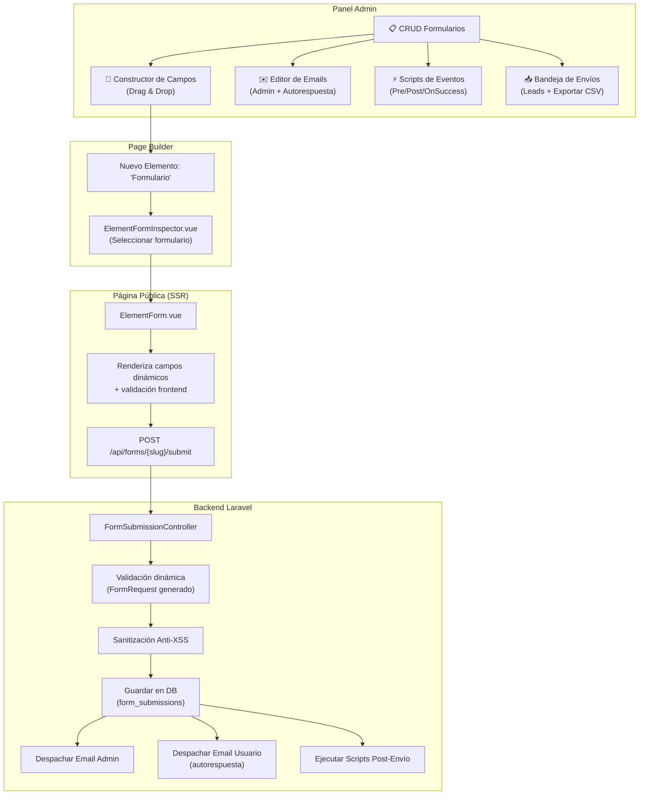
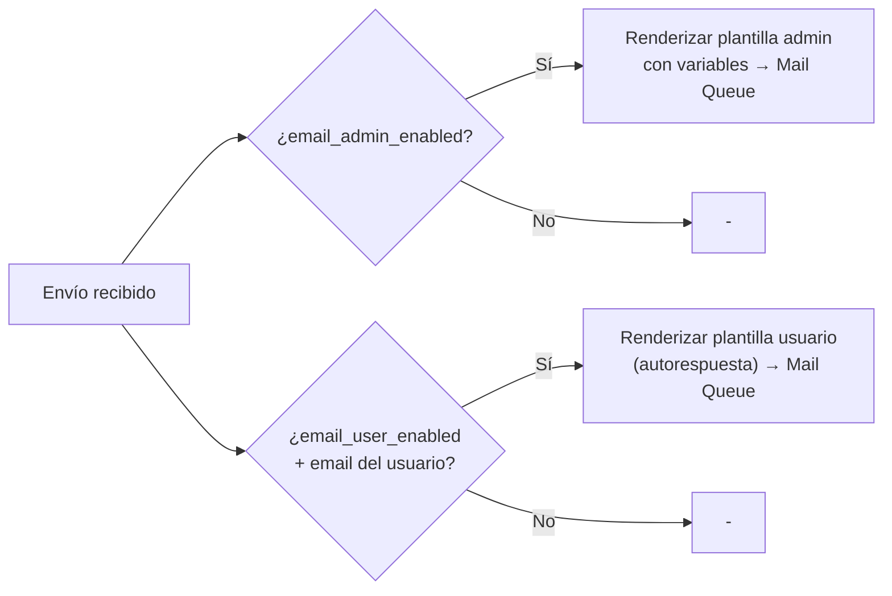

# 📋 Plan Módulo de Formularios Dinámicos — CMS SSR

## 1. Análisis: ¿Módulo Nativo o Librería Externa?

### 1.1. Opciones Externas Evaluadas

| Librería | Pros | Contras | Veredicto |
|:---|:---|:---|:---|
| **Vueform** | Constructor visual drag-and-drop, validación nativa, lógica condicional | Builder visual **de pago** (licencia comercial ~$150-500/proyecto). Peso bundle +80KB gzip. **Incompatible con SSR** de Inertia sin wrappers. Estilos propios que chocan con Tailwind/PrimeVue | ❌ Descartado |
| **FormKit** | Render formularios desde JSON Schema. Gratuito (core). Soporte Vue 3 | **No trae constructor visual** — hay que construirlo igualmente. Plugin Pro de pago. Validación propia que duplica la de Laravel | ❌ Descartado |
| **SurveyJS** | Muy maduro, builder drag-and-drop incluido | **Muy pesado** (+200KB gzip). Licencia comercial. Estilos propios incompatibles con diseño del CMS. No se integra con Inertia SSR | ❌ Descartado |
| **Form.io** | Suite completa con backend propio | Requiere servicio cloud externo o backend Node.js separado. Totalmente fuera de la arquitectura Laravel | ❌ Descartado |

### 1.2. Conclusión

> [!IMPORTANT]
> **El módulo nativo es la única opción viable** por estas razones:
> 1. **Ya tenemos todas las piezas**: vuedraggable, PrimeVue 4, Tailwind, sistema de inspectores del Builder, HtmlSanitizerService, arquitectura de servicios.
> 2. **Control total de seguridad**: Laravel's FormRequest, CSRF, Rate Limiting, sanitización — sin delegar en terceros.
> 3. **SSR Inertia**: Ninguna librería externa de formularios es compatible de forma nativa con nuestro stack SSR. El módulo nativo se renderiza exactamente como el resto de elementos del Builder.
> 4. **Diseño coherente**: Usa los mismos componentes PrimeVue y Tailwind del CMS sin choques de estilos.
> 5. **CMS multi-proyecto**: Al ser propio, se replica tal cual con el CMS sin dependencias de licencias externas por proyecto.
> 6. **Bundle zero**: No añade ni un KB extra de dependencias al frontend — solo componentes Vue propios.

---

## 2. Arquitectura del Módulo



---

## 3. Modelo de Datos

### 3.1. Tabla `forms` — Definición de formularios

| Campo | Tipo | Descripción |
|:---|:---|:---|
| `id` | bigint PK | — |
| `name` | string(255) | Nombre interno para el admin |
| `slug` | string(255) unique | Identificador público para URLs y Builder |
| `description` | text nullable | Descripción interna |
| `fields_schema` | json | Array JSON con la definición ordenada de campos |
| `settings` | json | Configuración general: botón, mensajes, redirección |
| `email_admin_enabled` | boolean default true | Enviar notificación al admin |
| `email_admin_template` | text nullable | Plantilla HTML del email al admin (con variables) |
| `email_admin_to` | string nullable | Destinatario(s) override. Si null → `SiteSetting::contact_email` |
| `email_user_enabled` | boolean default false | Enviar autorespuesta al usuario |
| `email_user_template` | text nullable | Plantilla HTML de autorespuesta (con variables) |
| `email_user_subject` | string nullable | Asunto personalizado |
| `email_user_field` | string nullable | Campo del formulario que contiene el email del usuario |
| `scripts_before` | text nullable | JavaScript a ejecutar antes de mostrar el formulario |
| `scripts_on_submit` | text nullable | JavaScript a ejecutar al enviar (antes del POST) |
| `scripts_after` | text nullable | JavaScript a ejecutar después del envío exitoso |
| `success_message` | string default 'Formulario enviado correctamente' | Mensaje de éxito |
| `success_redirect_url` | string nullable | URL de redirección tras envío (opcional) |
| `max_submissions_per_ip` | int nullable | Límite de envíos por IP (anti-spam) |
| `is_active` | boolean default true | Formulario habilitado/deshabilitado |
| `honeypot_field` | string nullable | Nombre del campo trampa anti-bot |
| `requires_captcha` | boolean default false | Activar Cloudflare Turnstile |
| `created_at` / `updated_at` | timestamps | — |

### 3.2. Tabla `form_submissions` — Envíos recibidos

| Campo | Tipo | Descripción |
|:---|:---|:---|
| `id` | bigint PK | — |
| `form_id` | bigint FK → forms | Relación con el formulario |
| `data` | json | Datos enviados (todos los campos key→value) |
| `ip_address` | string(45) | IP del remitente |
| `user_agent` | string(500) nullable | Navegador |
| `referer_url` | string(2048) nullable | Página desde la que se envió |
| `is_read` | boolean default false | Leído por el admin |
| `is_spam` | boolean default false | Marcado como spam |
| `email_sent_admin` | boolean default false | Se envió notificación al admin |
| `email_sent_user` | boolean default false | Se envió autorespuesta al usuario |
| `created_at` / `updated_at` | timestamps | — |

### 3.3. Esquema JSON de `fields_schema` (un campo)

```json
{
  "id": "campo_abc123",
  "type": "text|textarea|email|tel|number|select|checkbox|radio|date|file|hidden",
  "label": "Nombre completo",
  "name": "nombre_completo",
  "placeholder": "Escribe tu nombre...",
  "required": true,
  "validation_rules": "string|max:255",
  "options": [],
  "default_value": "",
  "css_class": "",
  "width": "full|half|third",
  "order": 0,
  "conditional": {
    "field": null,
    "operator": "equals|not_equals|contains|empty|not_empty",
    "value": null
  }
}
```

---

## 4. Seguridad — 7 Capas de Protección

> [!CAUTION]
> Los formularios públicos son la **superficie de ataque #1** de cualquier CMS. Cada capa actúa independientemente para que si falla una, las demás sigan protegiendo.

### Capa 1: CSRF Token (Laravel nativo)
- Cada envío requiere `_token` CSRF verificado por el middleware `VerifyCsrfToken`.
- Un bot sin sesión no puede enviar formularios.

### Capa 2: Rate Limiting por IP
- Middleware `throttle` configurable por formulario (ej: `throttle:5,1` = máx 5 envíos/minuto).
- `max_submissions_per_ip` como límite absoluto total en DB.
- Protege contra ataques de fuerza bruta y spam masivo.

### Capa 3: Campo Honeypot invisible
- Campo oculto por CSS que un humano nunca rellena. Si llega con datos → spam automático.
- Sin dependencias externas, 100% nativo.

### Capa 4: Cloudflare Turnstile (CAPTCHA invisible)
- **Opcional y configurable por formulario** (no todos lo necesitan).
- **Gratuito** y respetuoso con la privacidad (mejor que reCAPTCHA).
- Verificación server-side del token via API de Cloudflare.
- Se activa solo en formularios críticos (pagos, registros).

### Capa 5: Validación Server-Side Dinámica (FormRequest)
- Cada campo del `fields_schema` genera reglas de validación Laravel dinámicamente:
  - `email` → `['required', 'email:rfc,dns', 'max:255']`
  - `tel` → `['required', 'regex:/^[+]?[0-9\s\-()]{6,20}$/', 'max:20']`
  - `file` → `['file', 'max:10240', 'mimes:pdf,doc,docx,jpg,png']`
  - `text` → `['required', 'string', 'max:255']`
  - `textarea` → `['string', 'max:5000']`
  - `select/radio` → `['required', 'in:opcion1,opcion2,opcion3']`
- **Nunca se confía en la validación frontend** — el server siempre valida independientemente.

### Capa 6: Sanitización Anti-XSS
- `HtmlSanitizerService` existente aplicado a todos los campos de texto.
- `strip_tags()` + eliminación de atributos de evento JS (`onclick`, `onerror`, etc.).
- Campos como `email` y `tel` se filtran con regex estrictos.

### Capa 7: Protección Anti-Enumeración
- Ruta de envío por `slug` (no por `id` numérico) → no se puede escanear secuencialmente.
- Solo formularios con `is_active = true` aceptan envíos.
- Headers `X-Robots-Tag: noindex` en la ruta de envío.
- Los datos de `form_submissions.data` se almacenan cifrados en reposo si el campo es sensible.

---

## 5. Sistema de Scripts (Pre/During/Post)

> [!WARNING]
> Los scripts se ejecutan **solo en el frontend** (JavaScript del navegador del usuario). Nunca se ejecuta código arbitrario en el servidor. Se sanitizan al guardarlos en el admin.

| Evento | Cuándo se ejecuta | Casos de uso |
|:---|:---|:---|
| `scripts_before` | Al montar el componente `ElementForm.vue` | Tracking pixels, cargar datos externos, pre-rellenar campos desde URL params, analytics |
| `scripts_on_submit` | Justo antes del POST (cancelable) | Validaciones JS extra, convertir datos, confirmación custom, analytics de conversión |
| `scripts_after` | Tras respuesta exitosa del servidor | Redirigir, mostrar modal, enviar evento a GTM/Meta Pixel, cerrar widget |

**Implementación segura:**
- Los scripts se almacenan como texto plano en BD (solo accesible por admins autenticados).
- Se ejecutan via `new Function()` en un scope aislado con acceso a un objeto `formAPI` controlado.
- El administrador es responsable del código introducido (ejecución restringida a usuarios con rol admin).

---

## 6. Emails Editables con Variables

### Variables disponibles en las plantillas:

```
{form.name}              → Nombre del formulario
{form.submission_date}    → Fecha y hora del envío
{field.nombre_completo}   → Valor del campo "nombre_completo"
{field.email}             → Valor del campo "email"
{field.*}                 → Cualquier campo por su "name"
{site.name}               → Nombre del sitio (SiteSetting)
{site.url}                → URL del sitio
{submission.ip}           → IP del remitente
{submission.referer}      → Página desde la que envió
```

### Flujo de envío de emails:



- Los emails se despachan con **Queues** (`dispatch(new FormNotificationMail(...))->afterCommit()`) para no bloquear la respuesta al usuario.
- El `from` del email se toma de `SiteSetting::contact_email` o del `.env` como fallback.
- Las plantillas admiten HTML básico sanitizado — se editan con un mini editor WYSIWYG en el panel.

---

## 7. Tipos de Campo Soportados (23 tipos)

> [!NOTE]
> **No es una locura.** Todos los componentes ya están instalados en PrimeVue 4 — no se añade ni un KB de dependencias. La diferencia entre soportar 14 o 23 tipos es solo un `switch/case` en el renderizador y las reglas de validación. El 90% del trabajo es la arquitectura, no los campos.

### 7.1. Campos de entrada de texto

| Tipo | Componente PrimeVue | Validación Laravel | Uso típico |
|:---|:---|:---|:---|
| `text` | `InputText` | `string, max:255` | Nombre, asunto, empresa |
| `textarea` | `Textarea` | `string, max:5000` | Mensaje, comentarios |
| `email` | `InputText` type="email" | `email:rfc,dns, max:255` | Correo electrónico |
| `tel` | `InputText` type="tel" | `regex:/^[+]?[0-9\s\-()]{6,20}$/` | Teléfono |
| `url` | `InputText` type="url" | `url, max:2048` | Enlace web, portfolio |
| `password` | `Password` | `string, min:8, max:128` | Registro, acceso |
| `number` | `InputNumber` | `numeric, min, max` | Cantidad, edad, presupuesto |

### 7.2. Campos de selección

| Tipo | Componente PrimeVue | Validación Laravel | Uso típico |
|:---|:---|:---|:---|
| `select` | `Select` | `in:opciones` | Tipo de consulta, país |
| `multiselect` | `MultiSelect` | `array, in:opciones` | Servicios de interés, idiomas |
| `radio` | `RadioButton` group | `in:opciones` | Preferencia única con botones |
| `checkbox` | `Checkbox` | `boolean` o `array, in:opciones` | Aceptar términos, múltiple selección |
| `toggle` | `ToggleSwitch` | `boolean` | Suscribirse a newsletter, consentimiento |

### 7.3. Campos de fecha y hora

| Tipo | Componente PrimeVue | Validación Laravel | Uso típico |
|:---|:---|:---|:---|
| `date` | `DatePicker` | `date, before, after` | Fecha de evento, nacimiento |
| `datetime` | `DatePicker` showTime | `date_format:Y-m-d H:i` | Reserva con hora |
| `time` | `DatePicker` timeOnly | `date_format:H:i` | Hora de cita |

### 7.4. Campos especiales / interactivos

| Tipo | Componente PrimeVue | Validación Laravel | Uso típico |
|:---|:---|:---|:---|
| `file` | `FileUpload` | `file, max:10240, mimes:...` | Adjuntar CV, foto, PDF |
| `rating` | `Rating` | `integer, min:1, max:5` | Valoración, satisfacción |
| `slider` | `Slider` | `numeric, min, max` | Presupuesto estimado, rango |
| `color` | `ColorPicker` | `regex:/^#[0-9a-fA-F]{6}$/` | Preferencia de color |
| `hidden` | `<input type="hidden">` | Según config | UTM, tracking, datos internos |

### 7.5. Campos decorativos (sin validación)

| Tipo | Elemento HTML | Función |
|:---|:---|:---|
| `separator` | `<hr>` estilizado | Línea divisoria entre secciones |
| `heading` | `<h3>` / `<h4>` | Título de sección dentro del formulario |
| `paragraph` | `<p>` | Texto explicativo, instrucciones, avisos legales |

---

## 8. UX Frontend — Diseño Premium

### 8.1. Efectos y animaciones
- **Campos con aparición escalonada** (stagger animation) al entrar en viewport.
- **Validación en tiempo real** con micro-animaciones: bordes que cambian de color, iconos ✓/✗ animados.
- **Botón de envío** con estados visuales:
  - *Idle*: color primario del tema con hover scale/glow.
  - *Enviando*: spinner integrado + texto "Enviando…" + disabled.
  - *Éxito*: transformación a verde con icono ✓ animado (morphing).
  - *Error*: shake animation + toast de error.
- **Toast de confirmación** usando el sistema de Toast de PrimeVue que ya usa el CMS.
- **Lógica condicional visual**: campos que aparecen/desaparecen con transición suave según el valor de otros campos.

### 8.2. Responsivo
- Campos configurables como `full`, `half` o `third` (100%, 50%, 33% del ancho).
- En móvil todo colapsa a `full` automáticamente.

### 8.3. Temas
- Hereda automáticamente los colores del tema del sitio (claro/oscuro/primario).
- El admin puede sobreescribir el color del botón por formulario.

---

## 9. Panel Admin — Interfaces

### 9.1. Listado de Formularios (`/panel/formularios`)
- Tabla con nombre, slug, nº envíos, estado activo/inactivo, fecha.
- Botones: crear, editar, duplicar, eliminar.

### 9.2. Editor de Formulario (`/panel/formularios/{id}/editar`)
- **Tab Campos**: Constructor drag-and-drop con vuedraggable. Añadir/reordenar/eliminar campos. Inspector lateral por campo.
- **Tab Configuración**: Nombre, slug, mensaje de éxito, URL de redirección, texto del botón, estilo del botón.
- **Tab Emails**: Editor de plantilla admin + autorespuesta con WYSIWYG y preview de variables.
- **Tab Seguridad**: Honeypot on/off, Turnstile on/off, rate limit, máx envíos por IP.
- **Tab Scripts**: Editores de código para before/on_submit/after con syntax highlighting.

### 9.3. Bandeja de Envíos (`/panel/formularios/{id}/envios`)
- Tabla de envíos con filtros (leído/no leído, spam, fecha).
- Vista detalle de cada envío con todos los campos.
- Acciones: marcar leído, marcar spam, eliminar, exportar CSV.
- **Estadísticas**: total envíos, tasa spam, envíos por día (gráfico sparkline).

---

## 10. Integración con el Page Builder

### Nuevo elemento `form` en el catálogo:
```js
{ type: 'form', name: 'Formulario', icon: 'pi pi-inbox', desc: 'Formulario de contacto o captación de leads' }
```

### Componentes:
- `ElementFormInspector.vue` → Select para elegir formulario por slug + opciones de estilo.
- `ElementForm.vue` → Renderizado público dinámico del formulario con validación y envío AJAX.

---

## 11. Archivos a Crear

### Backend (Laravel)
| Archivo | Función |
|:---|:---|
| `database/migrations/xxx_create_forms_table.php` | Migración tabla `forms` |
| `database/migrations/xxx_create_form_submissions_table.php` | Migración tabla `form_submissions` |
| `app/Models/Form.php` | Modelo Eloquent con casts JSON, relaciones, scopes |
| `app/Models/FormSubmission.php` | Modelo de envíos |
| `app/Http/Controllers/FormController.php` | CRUD admin (Inertia) |
| `app/Http/Controllers/FormSubmissionController.php` | Bandeja de envíos admin |
| `app/Http/Controllers/PublicFormController.php` | Endpoint público de envío |
| `app/Http/Requests/StoreFormRequest.php` | Validación del formulario admin |
| `app/Services/FormSubmissionService.php` | Lógica de negocio: validar, sanitizar, guardar, despachar emails |
| `app/Services/FormValidationRuleBuilder.php` | Genera reglas de validación Laravel desde `fields_schema` |
| `app/Mail/FormAdminNotification.php` | Mailable para el admin |
| `app/Mail/FormUserAutoReply.php` | Mailable autorespuesta |
| `app/Http/Resources/FormResource.php` | API Resource para no exponer datos crudos |
| `app/Http/Resources/FormSubmissionResource.php` | API Resource de envíos |

### Frontend (Vue 3)
| Archivo | Función |
|:---|:---|
| `resources/js/Pages/Formularios/Index.vue` | Listado de formularios admin |
| `resources/js/Pages/Formularios/Edit.vue` | Editor con tabs (campos, config, emails, seguridad, scripts) |
| `resources/js/Pages/Formularios/Submissions.vue` | Bandeja de envíos |
| `resources/js/Components/Builder/Inspectors/ElementFormInspector.vue` | Inspector del Builder |
| `resources/js/Frontend/Builder/Elements/ElementForm.vue` | Renderizado público del formulario |
| `resources/js/Composables/useFormBuilder.js` | Composable para el constructor de campos |

### Tests
| Archivo | Cobertura |
|:---|:---|
| `tests/Feature/Controllers/FormControllerTest.php` | CRUD admin |
| `tests/Feature/Controllers/PublicFormControllerTest.php` | Envío público: validación, rate limit, honeypot, spam |
| `tests/Feature/Services/FormValidationRuleBuilderTest.php` | Generación de reglas desde schema |
| `tests/Feature/Mail/FormNotificationTest.php` | Envío y contenido de emails |

---

## 12. Fases de Implementación y Estado Actual

### ✅ Fase 1 — Cimientos y Backend Seguro (COMPLETADA)
- **Migraciones**: `forms` y `form_submissions` con índices para búsquedas ultra rápidas.
- **Modelos**: `Form` y `FormSubmission` con casts JSON y scopes.
- **Servicios**: `FormValidationRuleBuilder` (con validación de arrays wildcard, límite en hidden y whitelist de reglas) y `FormSubmissionService` (sanitización anti-XSS y honeypot).
- **Controladores y FormRequest**: `StoreFormRequest`, `FormController` y `PublicFormController` (`POST /f/{slug}`).
- **API Resources**: `FormResource` y `FormSubmissionResource`.
- **Tests**: 45 pruebas automatizadas pasando al 100%.

### ✅ Fase 2 — Constructor Visual y Panel Admin (COMPLETADA Y REFACTORIZADA)
- **Editor Visual (`Formularios/Edit.vue`) - Arquitectura Modular y Clean Code**:
  - Refactorizado a un orquestador conciso de ~330 líneas dividido en 8 submódulos especializados en `resources/js/Pages/Formularios/Partials/`:
    - `FieldPalette.vue`: Catálogo categorizado de 23 tipos de campo con buscador/filtro.
    - `FieldCanvas.vue`: Lienzo central drag & drop con `vuedraggable`, reordenación, clonación y eliminación.
    - `FieldInspector.vue`: Panel lateral de configuración de propiedades, lógica condicional dinámica y modal de importación de opciones en bloque.
    - `TabGeneralSettings.vue`: Nombre, slug con auto-slug, mensajes de éxito, redirección y diseño del botón de envío.
    - `TabEmailSettings.vue`: Notificaciones admin y autorespuesta al usuario con `WysiwygEditor.vue` e inserción de variables dinámicas en un clic.
    - `TabSecuritySettings.vue`: Rate limiting por IP, honeypot invisible y Cloudflare Turnstile.
    - `TabScriptsSettings.vue`: Scripts de ciclo de vida (`scripts_before`, `scripts_on_submit`, `scripts_after`).
    - `TabLivePreview.vue`: Vista previa interactiva completa con **Modo Simulación** y **Modo Envío Real a BD**, inspector reactivo de JSON en vivo y evaluación condicional en tiempo real.
  - Cumplimiento de la regla PrimeVue 4 para componentes `<Select>` (modelos computados con valor explícito `'none'`).
- **Listado Admin (`Formularios/Index.vue`)**: Métricas, buscador, toggle activo/inactivo, duplicación y eliminación.
- **Bandeja de Envíos (`Formularios/Submissions.vue` y `SubmissionDetail.vue`)**: Filtros (todos, no leídos, leídos, spam), modal de detalle completo y exportación a CSV con codificación UTF-8 BOM.
- **Navegación**: Entrada añadida al menú lateral del panel admin (`AuthenticatedLayout.vue`).

### ⏳ Fase 3 — Renderizado Público y Page Builder (SIGUIENTE PRIORIDAD)
- Creación de `resources/js/Frontend/Builder/Elements/ElementForm.vue` para renderizar el formulario en páginas SSR públicas.
- Integración en el Page Builder con `resources/js/Components/Builder/Inspectors/ElementFormInspector.vue`.
- Validación en cliente con feedback visual moderno y envío asíncrono con spinner, transiciones y toasts contra `/formularios/{slug}/enviar`.

### ⏳ Fase 4 — Seguridad y Turnstile en Producción
- Carga condicional del script de Cloudflare Turnstile solo cuando el formulario lo requiera.
- Verificación del token Turnstile en el backend vía API Cloudflare.
- Rate limiting con Redis y bloqueo anti-fuerza bruta.

### ✅ Fase 5 — Despacho de Emails y Notificaciones (COMPLETADA Y PROBADA)
- Mailable `App\Mail\FormNotificationMail` y plantilla responsiva `resources/views/emails/form-notification.blade.php`.
- Despacho inmediato y síncrono mediante transporte SMTP configurado (sin requerir worker de colas en segundo plano).
- Motor de sustitución de variables dinámicas (`{form.name}`, `{all_fields}`, `{field.*}`, `{site.name}`, etc.).
- Despacho doble: notificación al administrador y autorespuesta al usuario con tests automatizados en `FormNotificationTest.php`.

### ⏳ Fase 6 — Motor de Scripts Frontend y Polish
- Scope aislado para ejecución de `scripts_before`, `scripts_on_submit` y `scripts_after`.
- Eventos de seguimiento de conversiones (Google Tag Manager, Meta Pixel).

---

## 13. Dependencias Externas Necesarias

> [!NOTE]
> Solo **una** dependencia externa nueva, y es gratuita.

| Dependencia | Motivo | Impacto |
|:---|:---|:---|
| **Cloudflare Turnstile** (JS widget gratuito) | CAPTCHA invisible opcional | ~15KB async, solo se carga si el formulario lo requiere |

**No se necesita nada más.** Todo lo demás se construye con lo que ya tenemos: Laravel, PrimeVue 4, Tailwind, vuedraggable, Quill (para editor de plantillas email).
